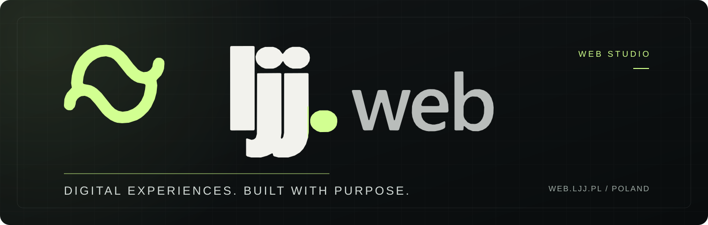

  

<h2 align="center">Thoughtful design. Meaningful digital experiences.</h2>

  We create distinctive digital experiences for businesses and brands — from the first idea to launch and ongoing development.

  <a href="https://web.ljj.pl"><strong>Explore our studio</strong></a>
  &nbsp;&nbsp;·&nbsp;&nbsp;
  <a href="mailto:web@ljj.pl"><strong>Work with us</strong></a>

---

### What we do

| Digital presence | Online commerce | Tailored solutions | Long-term care |
| :--- | :--- | :--- | :--- |
| Distinctive websites built around your brand. | Thoughtfully designed online shopping experiences. | Digital tools and features shaped around real needs. | Ongoing improvements, maintenance and support. |

### How we work

**Clarity first.** We focus on what a project should achieve, not just how it should look.

**Design with purpose.** Every detail should make the experience clearer, simpler and more useful.

**Built for tomorrow.** We plan for the next stage, not only the launch day.

---

  <strong>Have an idea? Let's talk.</strong> 
  We design, build, and grow digital experiences for businesses and brands.

  <a href="https://web.ljj.pl">web.ljj.pl</a> &nbsp;·&nbsp;
  <a href="mailto:web@ljj.pl">web@ljj.pl</a>

WEB-LJJ · Independent digital studio · Poland

